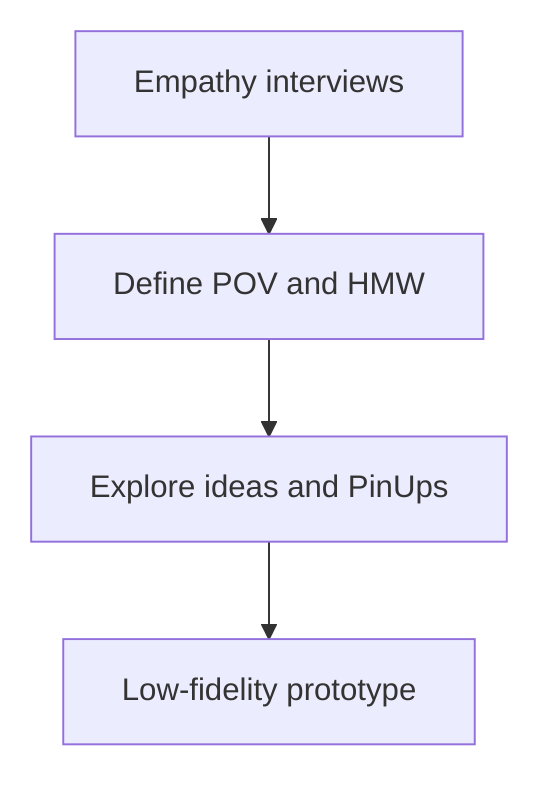

[Sprint framework]({{ '/sprints/' | relative_url }})

## Focus: User-Centered Design

Phase 1 generally aligns with the first week of the sprint. Understand your users before choosing a solution, then turn your findings into ideas and low-fidelity prototypes.

## Understand Your Users

Conduct empathy interviews and observe how people currently approach the problem.

- Ask about their goals, challenges, and existing workarounds.
- Listen for needs rather than asking users to approve your idea.
- Record useful quotes, observations, and unexpected insights.
- Use an empathy map or user journey to organize your findings.

## Define the Problem

Write a **Point of View (POV)** statement grounded in your research:

> [User] needs [need] because [insight].

For example: busy students need a quick way to find study groups because they struggle to connect with peers in large classes.

Frame **How Might We (HMW)** questions that invite solutions without prescribing one:

- How might we help students discover study opportunities?
- How might we help students form meaningful academic connections?
- How might we reduce the effort of organizing study sessions?

Keep the questions focused enough to guide your work and open enough to allow different ideas.

## Ideate and Share

Explore several possible solutions through brainstorming, sketches, mind maps, or storyboards.

- Defer judgment while generating ideas.
- Build on teammates' suggestions.
- Connect each idea to your POV and HMW questions.
- Share visual ideas in a PinUp and use feedback to choose a direction.

## Organize the Work

Create a [GitHub Projects board](https://docs.github.com/en/issues/planning-and-tracking-with-projects/learning-about-projects/about-projects) with **To Do**, **In Progress**, and **Done** columns.

Write user stories in the form “As a [user], I want [goal] so that [benefit].” Break them into issues and prioritize the work by user value and effort.

## Create a Low-Fidelity Prototype

Make the proposed experience tangible without building the full product.

- Use paper sketches, [Canva](https://www.canva.com/), or [Figma](https://www.figma.com/) for interface mockups.
- Use [draw.io](https://draw.io/) or Mermaid for system and interaction diagrams.
- Focus on the main user need, not visual polish.
- Present the prototype to your Product Owner (teacher) and record feedback.

## Phase Outcomes

- Empathy research and a clear POV statement.
- HMW questions grounded in user needs.
- Visual ideas shared through a PinUp.
- A Kanban board with initial user stories and issues.
- A low-fidelity prototype ready to guide Phase 2.

## Resources

- [IDEO's Design Thinking Process](https://designthinking.ideo.com/)
- [Interaction Design Foundation: What Is Design Thinking?](https://www.interaction-design.org/literature/topics/design-thinking)
- [Agile User Stories](https://www.mountaingoatsoftware.com/agile/user-stories)
- [Figma Beginner's Guide](https://help.figma.com/hc/en-us/articles/360040514073-Learn-Figma)

[Next: Phase 2 — Build]({{ '/sprints/week2' | relative_url }})
