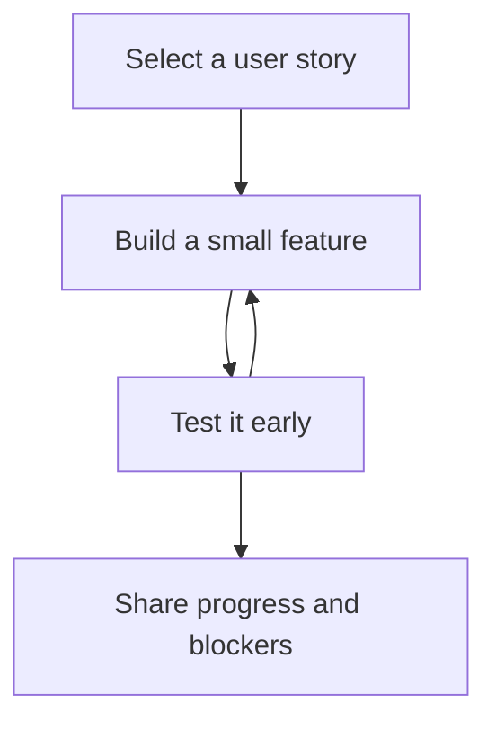

[Sprint framework]({{ '/sprints/' | relative_url }})

## Focus: From Ideas to Code

Phase 2 generally aligns with the second week of the sprint. Use your Phase 1 prototype and user stories to build working features that address the identified user need.

## Prepare Your Development Environment

- Clone or update the team repository and open it in VS Code.
- Install required dependencies and verify the local development server.
- Create a feature branch for your work.
- Keep setup instructions in the README so teammates can reproduce your environment.

## Implement Features

Choose work from your Kanban board and build the simplest useful version first.

### Frontend

- Implement GitHub Pages components, layouts, and user interactions.
- Connect interface behavior to the prototype and user story.
- Check that the interface works on mobile as well as desktop.

### Backend

- Implement API endpoints and the data operations your feature needs.
- Define data models and relationships.
- Handle authentication and invalid input where required.
- Check endpoints with tools such as Postman or `curl`.

Commit small, focused changes with messages that explain what you built.

## Test Early

Test each feature as you build it rather than waiting for the final week.

- Add unit tests for important behavior.
- Check normal inputs, edge cases, and error handling.
- Use browser DevTools to investigate interface problems.
- Confirm that the feature satisfies its user story.

Technical checks here support building; broader integration belongs to Phase 3, and user validation belongs to Phase 4.

## Cohort Scrum Standups

Scrum Masters lead short standups to coordinate work and identify blockers.

- What did you complete?
- What will you work on next?
- What is blocking you?
- Who can help, pair program, or share a useful solution?

Keep updates focused on what affects the team. Use cross-team conversations to exchange knowledge and coordinate dependent features.

## Phase Outcomes

- Working GitHub Pages features or API endpoints tied to user stories.
- Features tested individually, with known issues recorded.
- Focused commits and up-to-date setup documentation.
- A project board that reflects actual progress.
- Clear dependencies and blockers to address during Phase 3.

[Previous: Phase 1 — Design & Ideate]({{ '/sprints/week1' | relative_url }}) · [Next: Phase 3 — Integrate]({{ '/sprints/week3' | relative_url }})
