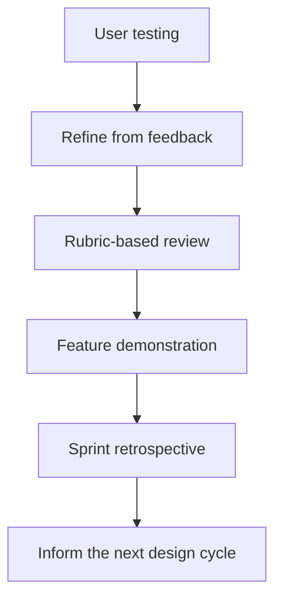

[Sprint framework]({{ '/sprints/' | relative_url }})

Phase 4 generally aligns with the fourth week of the sprint. **Test** asks whether the product meets user needs; **Retrospective** asks what the team learned and how it will improve.

## Test

### Conduct User Testing

Return to your original POV statement and HMW questions. Check whether the product solves the problem you set out to address.

- Ask peers to complete realistic tasks using your product.
- Observe where they succeed, hesitate, or become confused.
- Invite users to explain their thinking as they work.
- Record quotes, pain points, successful interactions, and suggestions.
- For each key task, record the expected result, what actually happened, and any follow-up issue.

Avoid coaching users through every step: their experience is evidence for improving the design.

### Refine the Solution

Prioritize changes supported by testing feedback.

- Fix problems that prevent users from completing key tasks.
- Improve unclear interactions, content, and accessibility.
- Polish existing features rather than expanding scope at the last minute.
- Recheck the affected user paths after making changes.

### Rubric-Based Review

Use the project rubric to assess readiness and identify remaining gaps.

- Compare the product with requirements and learning objectives.
- Confirm which features work and which remain incomplete.
- Connect your evidence to user research, design decisions, and technical implementation.
- Prepare an honest account of strengths and limitations.

### Feature Demo Presentation

Demonstrate the product to your Product Owner (teacher) using a real user scenario.

- Introduce the original problem and user need.
- Show the working features that address that need.
- Explain how testing feedback influenced your refinements.
- Highlight learning and acknowledge unresolved limitations.

Rehearse the demonstration and prepare a backup for technical problems.

### Resource

- [Nielsen Norman Group: Usability Testing 101](https://www.nngroup.com/articles/usability-testing-101/)

## Retrospective

Reflect as a team on the process as well as the product.

- What worked well in research, design, building, and integration?
- What would you approach differently?
- What did you learn about users, tools, and collaboration?
- What feedback should inform the next design cycle?

Document the takeaways and schedule individual teacher check-ins for feedback on your growth.

### Choose a Next-Sprint Action

Choose one improvement the team can try next sprint, identify who will lead it, and agree on how you will tell whether it helped.

Keep the discussion candid and constructive: focus on decisions, habits, and collaboration rather than blame. Unexpected results and unfinished work can be useful learning evidence.

### Phase Outcomes

- User-testing evidence connected to the original POV and HMW questions.
- Refinements based on observed user needs.
- A rubric-based self-assessment with supporting evidence.
- A feature demonstration and feedback from the Product Owner.
- Retrospective insights to guide the next sprint.
- An actionable improvement to revisit during the next sprint.

[Previous: Phase 3 — Integrate]({{ '/sprints/week3' | relative_url }}) · [Return to the sprint framework]({{ '/sprints/' | relative_url }})
