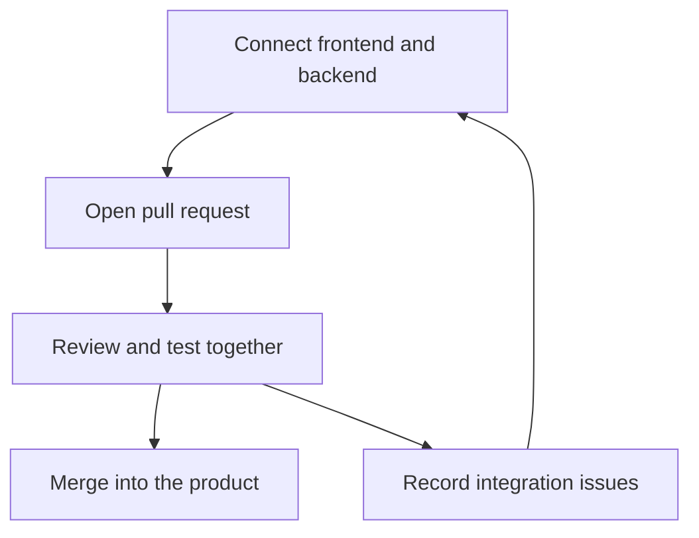

[Sprint framework]({{ '/sprints/' | relative_url }})

## Focus: Team Integration

Phase 3 generally aligns with the third week of the sprint. Combine the features built in Phase 2 into a unified product and resolve the problems discovered where components meet.

## Connect the Systems

- Agree on API requests, responses, and error behavior.
- Connect frontend interactions to backend services.
- Check that authentication and data flow work across components.
- Coordinate dependencies and environment settings across the team.

Test complete paths through the connected system, not just individual features.

## Review and Merge

Use pull requests to make integration work visible and reviewable.

- Update your branch with the team's current work.
- Explain what changed and how reviewers can test it.
- Give constructive feedback and respond to review comments.
- Resolve merge conflicts together when changes overlap.
- Verify the combined product after merging.

## Collaborate on Derived Issues

When integration reveals a new problem, create a GitHub issue describing what happened, why it matters, and the next action.

For example, an expired session may leave the frontend showing a logged-in state. Record the observed behavior and coordinate the frontend and backend changes needed to handle it.

Assign ownership and link related issues or pull requests so discoveries become actionable work.

## Track Progress with Burndown Charts

Record remaining work each day and compare it with the sprint goal.

Use the project board, issues, and actual contribution records to identify unfinished integrations and blockers. Discuss changes in scope with your team rather than treating activity counts as completion.

## Phase Outcomes

- Frontend and backend features working together.
- Reviewed pull requests merged into the shared product.
- Integration discoveries documented as issues with owners.
- Updated burndown and project-board records.
- A coherent product ready for user testing in Phase 4.

[Previous: Phase 2 — Build]({{ '/sprints/week2' | relative_url }}) · [Next: Phase 4 — Test & Retrospective]({{ '/sprints/week4' | relative_url }})
