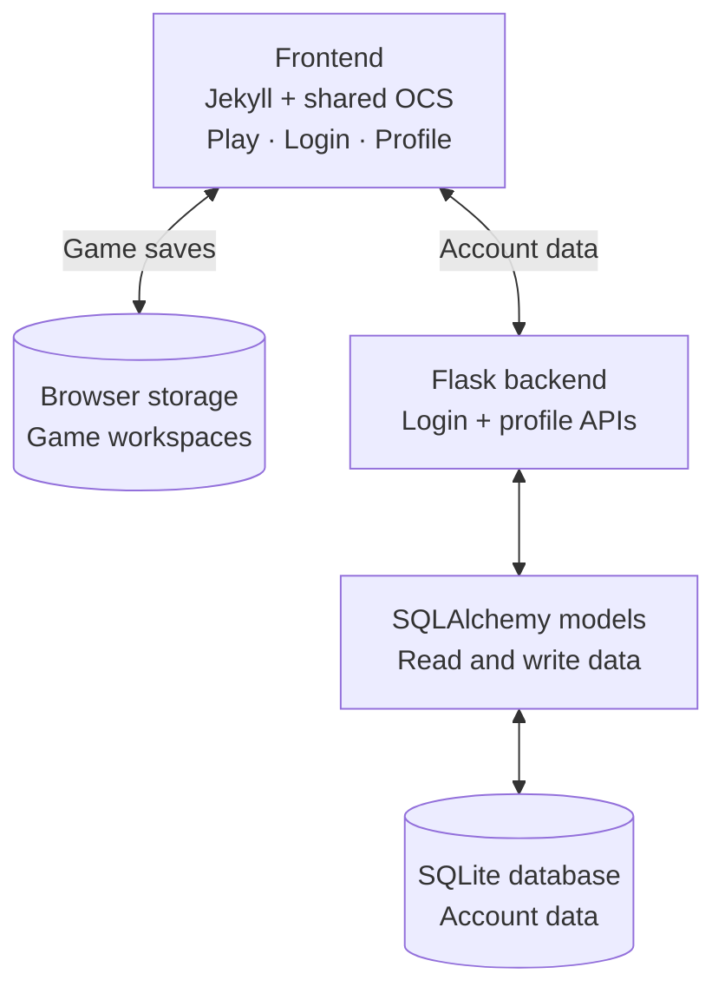

> We are Adhvay, Rohan, and Ishan. We are building an accessible space where UESL participants can create and play their own games, learn through experimentation, and eventually share those experiences with others.

    <a class="ocs__btn alert-green fill large" href="#two-minute-demo">Two-minute walkthrough</a>
    <a class="ocs__btn large" href="#team-kanban">Team Kanban</a>
    <a class="ocs__btn large" href="https://www.unifiedesl.com/" target="_blank" rel="noopener noreferrer">Visit UESL</a>

## Community contact

    

        <strong>Matthew Iske · UESL</strong>
        
Founder and CEO; Programs and Partnerships contact.

        
<a href="mailto:matthew@unifiedesl.com">matthew@unifiedesl.com</a>

        <a class="ocs__btn small" href="https://www.unifiedesl.com/about" target="_blank" rel="noopener noreferrer">Meet the UESL team</a>
    

    

        <strong>Why UESL?</strong>
        
UESL connects people with intellectual and developmental disabilities through gaming and technology. Our proposed contribution is a game-making activity where participants can create, experiment, and learn at their own pace.

        <a class="ocs__btn small" href="https://www.unifiedesl.com/" target="_blank" rel="noopener noreferrer">UESL website</a>
    

    

        <strong>What we want to learn</strong>
        
Which activities, controls, and accessibility settings would help your participants most?

        
We are seeking Matthew's feedback on the prototype and its fit for UESL. A rollout or partnership has not been confirmed.

    

<h2 id="two-minute-demo">Our project in two minutes</h2>

**Create → play → keep improving.** This is the structure of our local GameMaker prototype. This OCS page is our project and feedback hub; the game runs in the separate GameMaker app.

**How it connects**

**Read the diagram:** the frontend handles controls and gameplay. JavaScript exchanges JSON with Flask using the login cookie; Flask checks the request, then the models read or update SQLite. Play saves stay in the browser. The newer editor has a separate game-save API, but connecting the inherited builders to account saves is still planned.

<strong>0:00–0:40 · Rohan · The idea</strong>

<strong>Say:</strong> “We want UESL participants to move from playing games to creating them. Our prototype brings three builders into one workspace. Participants can make a small change, see its result, and learn by experimenting. We want UESL's feedback to shape the next version.”

<strong>Show:</strong> Open Play, point out the three builder tabs, then choose OpenCS Workbench and change the player or background.

<strong>0:40–1:20 · Ishan · The experience</strong>

<strong>Say:</strong> “The setup controls, game preview, and code sit together. Push turns our choices into code, and Run lets us try the result. We can stop, adjust, and try again. Saving a workspace gives us a return point on this browser.”

<strong>Show:</strong> Select Push →, Run, then Stop. Select Save Workspace, change one choice, and use Load Saved Workspace to restore it.

<strong>1:20–2:00 · Adhvay · The structure</strong>

<strong>Say:</strong> “The browser runs the game. Our Flask backend handles login and profile data, which stays in SQLite. Connecting builder saves to accounts is next. Multiplayer and chat are future ideas, and UESL's feedback will help us choose what to build first.”

<strong>Show:</strong> Point to the diagram, then save a display-name change in Profile and reload. End with: “What would make this useful for your participants?”

Presenter setup and demo checkpoints

- Start `bash run_backend.sh` in `GameMaker-CSP/Backend` and `bash run_frontend.sh` in `GameMaker-CSP/Frontend`.
- On the presenter's laptop, open `http://localhost:4700/play/` and `http://localhost:4700/profile` in separate tabs. Sign in beforehand using your local demo account; prepare a workspace you are comfortable replacing.
- Run `python3 scripts/check_localhost.py` from the frontend folder. This checks page availability, backend health, and signed-out authentication; rehearse the interactive steps separately.
- Check that Run responds, Load Saved Workspace restores the saved choice, and Profile shows its saved confirmation before reloading. Restore the original display name after the demo.
- **Keep the claims clear:** login/profile and local builder saves are the demo. Guided mode, connecting inherited builder saves to accounts, multiplayer, and chat remain planned work. The existing `/api/game/*` API uses a different format from the inherited `/api/gamebuilder` requests.

<h2 id="team-kanban">Team Kanban</h2>




    <a class="ocs__btn alert-green fill large" href="https://github.com/GameMaker-CSP/Frontend/issues/1" target="_blank" rel="noopener noreferrer">Open Sprint Plan</a>
    <a class="ocs__btn large" href="https://github.com/GameMaker-CSP/Frontend" target="_blank" rel="noopener noreferrer">Team Repository</a>
    <a class="ocs__btn large" href="https://github.com/Malware-Madness/MalwareMadness" target="_blank" rel="noopener noreferrer">Original Project</a>

 

    
Project Direction

    

        <strong>Current strengths</strong>
        
The local prototype brings OpenCS Workbench, Open World, and Racing together with previews and browser saves. Flask login and profile updates connect to SQLite; inherited builder account saving still needs integration.

    

    

        <strong>User problem</strong>
        
First-time participants can face too many technical choices at once, making it difficult to reach a confident first playable result.

    

    

        <strong>Sprint direction</strong>
        
The original guided-mode sprint below remains a plan: one meaningful choice at a time while keeping the advanced editor available. Login/profile work is tracked separately; multiplayer and chat are future ideas, outside the current demo.

    

 

---

## Planned six-step experience

These are acceptance criteria for the guided mode, not the current Play walkthrough above.

    

        <strong>01 · Start</strong>
        
Create a new game or restore a clearly labeled browser draft.

        
<strong>Done when:</strong> either path reaches the builder without losing valid work.

    

    

        <strong>02 · Choose</strong>
        
Name the game and select the supported platform-runner template.

        
<strong>Done when:</strong> missing fields show a useful correction and preserve other choices.

    

    

        <strong>03 · Customize</strong>
        
Choose a visual theme, challenge level, and game speed through clear controls.

        
<strong>Done when:</strong> Back and Continue preserve every valid selection.

    

    

        <strong>04 · Accessibility</strong>
        
Apply a preset, then adjust contrast, motion, control size, or speed individually.

        
<strong>Done when:</strong> at least three settings visibly change the preview.

    

    

        <strong>05 · Preview</strong>
        
Start, pause, reset, and exit one proven game-engine template.

        
<strong>Done when:</strong> a preview failure returns safely to the builder.

    

    

        <strong>06 · Save</strong>
        
Review the configuration, edit a choice, and save a compatible local draft.

        
<strong>Done when:</strong> refresh, restore, and corrupted-data recovery pass.

    

 

---

## Team ownership

> Each teammate owns implementation, testing, review, revision, and portfolio evidence for one complete part of the workflow.

    

        <strong>Rohan Chandra · Developer</strong>
        
Own the guided builder interface and navigation between the six steps.

        <ul>
            <li>Build semantic, responsive builder states.</li>
            <li>Connect controls to the shared state.</li>
            <li>Test keyboard order, Back behavior, mobile, and zoom.</li>
        </ul>
        
<strong>Done when:</strong> the full path preserves choices and never relies on color alone.

        <a class="ocs__btn small" href="https://github.com/GameMaker-CSP/Frontend/issues/2" target="_blank" rel="noopener noreferrer">Rohan's Issue</a>
    

    

        <strong>Ishan Srivastava · Scrum Master / Developer</strong>
        
Own the accessible preview while coordinating the sprint and integration checkpoints.

        <ul>
            <li>Build presets and stable preview controls.</li>
            <li>Run standups and maintain the Kanban board.</li>
            <li>Lead reviews, unblock dependencies, and record revisions.</li>
        </ul>
        
<strong>Done when:</strong> three settings affect the preview and every sprint gate has evidence.

        <a class="ocs__btn small" href="https://github.com/GameMaker-CSP/Frontend/issues/3" target="_blank" rel="noopener noreferrer">Ishan's Issue</a>
    

    

        <strong>Adhvay Iyer · Developer</strong>
        
Own configuration, validation, browser drafts, and the adapter to the existing game data.

        <ul>
            <li>Define the shared builder-state contract.</li>
            <li>Build the parameterized configuration procedure.</li>
            <li>Test missing, conflicting, valid, and corrupted data.</li>
        </ul>
        
<strong>Done when:</strong> valid input becomes a compatible preview configuration and drafts restore safely.

        <a class="ocs__btn small" href="https://github.com/GameMaker-CSP/Frontend/issues/4" target="_blank" rel="noopener noreferrer">Adhvay's Issue</a>
    

 

---

## Planning and iteration

    
Two-week Sprint

    

        <strong>Week 1 · Prove the path</strong>
        <ol>
            <li>Audit reuse points and agree on the shared state.</li>
            <li>Build each teammate's smallest working slice.</li>
            <li>Integrate Start through Preview.</li>
            <li>Record teacher or peer feedback in the issue.</li>
        </ol>
    

    

        <strong>Week 2 · Revise and verify</strong>
        <ol>
            <li>Correct interaction and integration problems.</li>
            <li>Complete save, restore, and preview recovery.</li>
            <li>Test keyboard, phone, zoom, and invalid data.</li>
            <li>Deploy, teammate-verify, demonstrate, and reflect.</li>
        </ol>
    

    

        <strong>Kanban and reviews</strong>
        
To do → In progress → In review → Done. Future work stays in Backlog.

        
Each pull request links its issue, lists its tests, receives teammate review, and records the resulting revision.

    

 

---

## Testing and CSP evidence

    
Demo Readiness

    

        <strong>Guided-mode acceptance target</strong>
        
Create a named game → apply an accessible preset → override one setting → preview → save → refresh → restore.

    

    

        <strong>Acceptance checks</strong>
        
Keyboard and focus · reduced motion · 200% zoom · phone and desktop · validation · corrupted-draft recovery · preview controls · save and restore.

    

    

        <strong>CSP evidence</strong>
        
Issues, commits, Kanban movement, teammate reviews, feedback, and correcting revisions document collaboration and iteration.

        
Inputs are game and accessibility choices. Events navigate, validate, preview, save, and restore. Outputs are feedback and configured gameplay. Data is stored in one builder-state object.

    

 

    <a class="ocs__btn alert-green fill" href="https://github.com/GameMaker-CSP/Frontend/issues/1" target="_blank" rel="noopener noreferrer">View Team Plan</a>
    <a class="ocs__btn" href="https://github.com/GameMaker-CSP/Frontend" target="_blank" rel="noopener noreferrer">View Repository</a>

