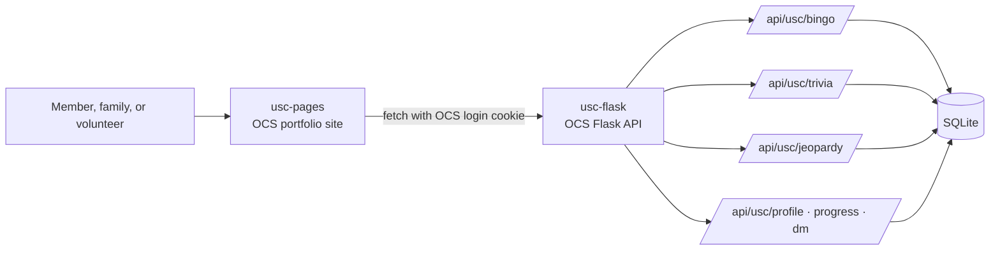
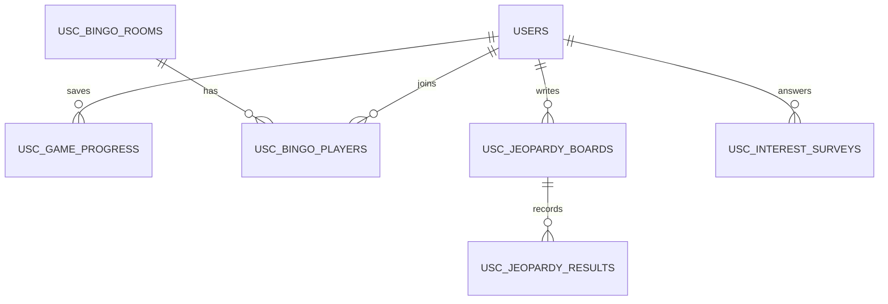

> [Unified Social Club](https://www.unifiedsocialclub.com/) gives adults with special needs in Poway a free, safe place to make friends: board and card games, arts and crafts, karaoke, and sports at the Mickey Cafagna Community Center (13094 Civic Center Dr, Poway). Games are the heart of every club night, so Team Triple T is building three club games members can play together on the big screen or on their own phones.




    <a class="ocs__btn alert-green fill large" href="https://github.com/Unified-Social-Club-CSP/usc-pages/issues/1" target="_blank" rel="noopener noreferrer">Open Sprint Plan</a>
    <a class="ocs__btn large" href="https://unified-social-club-csp.github.io/usc-pages/" target="_blank" rel="noopener noreferrer">Our Live Site</a>
    <a class="ocs__btn large" href="https://www.unifiedsocialclub.com/" target="_blank" rel="noopener noreferrer">Their Website</a>

 

    
Who We Serve

    

        <strong>Current strengths</strong>
        
Free for members, with refreshments covered by sponsors. Strong support from the City of Poway and community partners, and a clear FAQ on aides, service animals, and photo consent.

    

    

        <strong>User problem</strong>
        
Club dates are listed out of order with no times, there is no phone or email on the site, and nothing online lets members take part between club nights.

    

    

        <strong>Contact and history</strong>
        
We reach the club through the <a href="https://www.unifiedsocialclub.com/blank-4" target="_blank" rel="noopener noreferrer">volunteer registration</a> and <a href="https://www.unifiedsocialclub.com/event-list" target="_blank" rel="noopener noreferrer">club dates</a> pages. Every conversation is recorded in the microblog on this page.

    

 

---

## Three club games

> Each teammate owns one game from design through testing. Every game works on the big screen at club night and on one phone at home.

    

        <strong>Club Bingo · Kashyap</strong>
        
Big-print Bingo with a caller that reads every number out loud. Play solo or join friends with a 4-digit room code.

        
<strong>Done when:</strong> the server checks every BINGO claim and wins show on the member's profile.

        <a class="ocs__btn small" href="https://github.com/Unified-Social-Club-CSP/usc-pages/issues/13" target="_blank" rel="noopener noreferrer">Kashyap's Issue</a>
    

    

        <strong>Club Trivia Live · Chetan</strong>
        
A live game show like Kahoot. The host shows each question on the big screen and members answer with four big picture buttons on their phones.

        
<strong>Done when:</strong> a room of players sees one timer and one live scoreboard.

        <a class="ocs__btn small" href="https://github.com/Unified-Social-Club-CSP/usc-pages/issues/14" target="_blank" rel="noopener noreferrer">Chetan's Issue</a>
    

    

        <strong>Club Jeopardy · Aaditya</strong>
        
Teams take turns picking club-life categories and points. Volunteers write their own boards, and finished games are saved.

        
<strong>Done when:</strong> a volunteer's new board is playable and the server checks every saved score.

        <a class="ocs__btn small" href="https://github.com/Unified-Social-Club-CSP/usc-pages/issues/15" target="_blank" rel="noopener noreferrer">Aaditya's Issue</a>
    

 

---

## Built into every game

    
Shared Features

    

        <strong>Nod to select</strong>
        
A head nod presses the highlighted button, so members who can't use a mouse play on their own.

    

    

        <strong>Easy to read</strong>
        
Text-size buttons that use the OCS font-size preference, plain words, pictures on every answer, and clues read out loud.

    

    

        <strong>One OCS account</strong>
        
OCS login with roles for members, families, and volunteers, a tap-only interest survey, and saved progress for every game.

    

 

---

## System design

> The frontend is our OCS portfolio site on GitHub Pages; the backend is OCS Flask. Each game has its own API, and all three share the OCS user table.

---

## Planning and iteration

    
Sprint 3

    

        <strong>Ideate, define, prototype</strong>
        <ol>
            <li>Empathy notes and how-might-we questions for each game.</li>
            <li>Home, Login, and Survey working full-stack.</li>
            <li>A playable first version of each game.</li>
        </ol>
    

    

        <strong>Night at the Museum</strong>
        <ol>
            <li>Talk with visitors first; demo second, under a minute.</li>
            <li>Run usability tests on all three games.</li>
            <li>Record feedback in issues and the microblog.</li>
        </ol>
    

    

        <strong>Kanban and reviews</strong>
        
Backlog → To do → In progress → In review → Done, with Quick and Formal issue templates.

        
Each pull request links its issue, lists its tests, and gets a teammate review.

    

 

---

## Testing and CSP evidence

    
Demo Readiness

    

        <strong>Final demo path</strong>
        
Sign in → answer the survey → turn on Nod to select → play a round of each game → see progress saved on the profile.

    

    

        <strong>Acceptance checks</strong>
        
Keyboard and Nod to select · large text · phone and big screen · server-checked scores · signed-out play still works.

    

    

        <strong>CSP procedures</strong>
        
Kashyap: <code>checkBingo(card, called)</code>. Chetan: <code>scoreRound(answers, correctIndex, timeLimit)</code>. Aaditya: <code>scoreAnswer(teams, teamIndex, clue, choiceIndex)</code>. Each uses a list, a loop, and a condition.

    

 

    <a class="ocs__btn alert-green fill" href="https://github.com/orgs/Unified-Social-Club-CSP/projects/2" target="_blank" rel="noopener noreferrer">View Kanban</a>
    <a class="ocs__btn" href="https://github.com/Unified-Social-Club-CSP/usc-pages" target="_blank" rel="noopener noreferrer">Frontend Repository</a>
    <a class="ocs__btn" href="https://github.com/Unified-Social-Club-CSP/usc-flask" target="_blank" rel="noopener noreferrer">Backend Repository</a>

