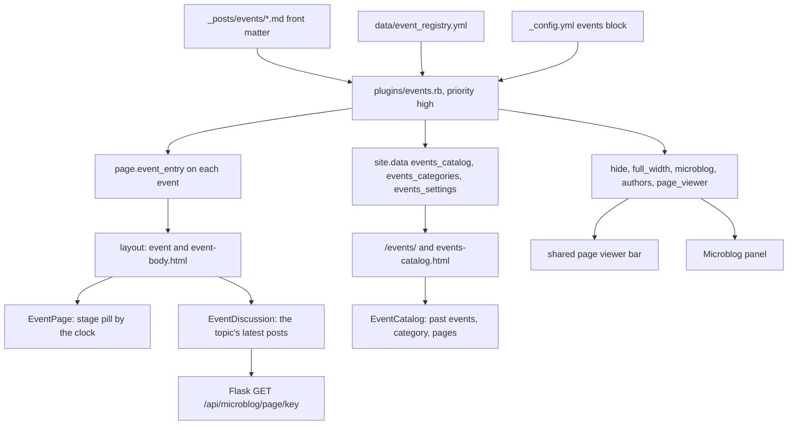

## View and data source

Events has two views, both static pages that Jekyll builds from front matter:

- An event page (`layout: event`), Mort's Example Event Viewer: the photo and its credit, the
  stage pill, the title, the date line, the description, the place, the Event Sections cards and
  Questions and Discussion.
- `/events/`, Mort's Upcoming Events: a tinted band with Join Us, a category filter, the cards
  three across with Earlier and Later six at a time, and Past Events.

Each event is a post in `_posts/events/` with Mort's front matter and an explicit
`permalink: /events/<slug>/`. The words and choices come from the registry,
`data/event_registry.yml`, and the site defaults from the `events:` block in `_config.yml`.

## The generator

`plugins/events.rb` (`Events::Generator`) runs at priority `:high`, before the course reader
(`:normal`) and the Topics and Capstone generators (`:lowest`). For every document with
`layout: event` it:

- checks the front matter against the registry and stops the build naming the file and the field;
- drops `status: draft` unless the build uses `--unpublished`, since a draft belongs in the Event
  Builder, never in the public repo;
- sets `hide: true`, which Blogs, Topics, Capstone, the course reader and the category blocks read
  as "leave out of this list", so `/events/` and its category filter are how people find events;
- sets `full_width`, `microblog` from the event's `features.microblog` (a key the event leaves out
  takes `events.features`), `authors` from `organizer.uids` while the Microblog is on, and the
  shared `page_viewer` on listed events;
- builds `page.event_entry`: the checked values, the date line and card date in the registry's
  formats, the place, the presenters with the organizer first, the section cards that have content,
  the page's words with the event's own `labels` over the registry's, and schema.org Event data for
  events that aren't samples.

It writes `site.data["events_catalog"]` (listed events by day, start time, then title),
`["events_categories"]` (one lowercase key per category) and `["events_settings"]`.

## The browser

The site rebuilds only on a push, so the static page never claims a live state. The scripts are
classes, imported from `/assets/js/projects/events/`:

- `EventTime` reads wall-clock times in the event's time zone and shows the later of the built
  stage and the clock's on the pill. `registration` is built as Published until the Event Service
  can take RSVPs.
- `EventCatalog` moves the events that have ended under Past Events, filters both grids by
  `?category=`, and shows a page of each (`?page=` and `?past=`, with `EventPager`). Cards move in
  and out of the grids, because an `ocs__grid-cell`'s display beats `[hidden]`. It saves the
  filtered order in sessionStorage for the viewer.
- `EventPage` updates the pill, shows Ask a question when the Microblog panel is on the page, and
  starts `EventDiscussion`, which lists the topic's latest posts by first name, as text.
- `EventViewer` (through `viewer.js`'s `startViewer`, which Mort's `page-viewer.html` calls) points
  Back at the category and page that were showing and sets previous and next across pages.
- `EventTexts` reads the registry's words, which `event-texts-json.html` writes into each page.

## What it covers of the Event

Of the six parts Mort's Event connects:

| Part | Here |
|---|---|
| Documents | the page body, and a link to its presentation; files come from the Event Service |
| Media | the photo and its credit; galleries come from the Event Service |
| Microblog | the discussion: the panel, and the latest questions on the page |
| Participants | not yet: RSVPs and check-in are the Event Service's |
| Scheduling | the date, times, time zone, place and schedule |
| Presentation | the event page itself, the shared viewer, and a link to a UI Builder page |

## Boundaries

- Flask's Event Service owns RSVPs, attendance and files. These pages show no seats, check-in or
  gallery until it can.
- The Microblog owns discussion, in its own storage. The page reads a topic through the
  Microblog's `MicroblogTopic` (`js/microblog-topic.js`), the one copy of Flask's page key.
- Calendar owns calendar items. Events adds none here.
- Every visible word is in the registry; the page uses the `ocs__` grammar only, with no page
  styles.
