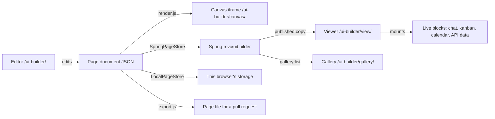

## What it is

The UI Builder lets a student make a page on this site without writing HTML. A page is a
JSON **document** of **sections** ("One column" or "Columns") holding **blocks**. Blocks are
the shared `ocs__` grammar (headers, cards, stats, tables, link cards…), live **communication
blocks** (group chat, announcements, message us, team members, calendar, kanban, visitor
feedback) and **project blocks** (data from your API, embed your app). One renderer turns a
document into `ocs__` markup. Nothing a student types ever runs as HTML or JavaScript.



## Flask only or Flask + Spring

| | Flask only (`spring: false`) | Flask + Spring |
|---|---|---|
| Save | this browser (`LocalPageStore`) | Spring (`SpringPageStore`), with a browser copy for crash recovery |
| Share | export the page file or JSON | publish, then the viewer link and the gallery |
| Blocks | every block except the ones that need Spring (chat, members, message us, announcements, calendar, visitor feedback) | every block |
| Team editing | no | owner, teachers and the page's team group |

A **store** is the object that keeps pages. Each page's bootstrap (the script at the end of
`pages/*.md`) picks the store class once from `config.js` `springEnabled`. After that the
editor reads only `store.capabilities` and never checks `springEnabled` itself, and a
Flask-only site sends no request to Spring. Visitor feedback needs Spring too: its posts go to
Flask's microblog, filed under the page's published address, and only Spring publishes.
Whether Flask should store pages too is an open question for the kit owners.

## Pages

| Route | Source | What it is |
|---|---|---|
| `/ui-builder/` | `pages/editor.md` | the editor (`?page=<id>` Spring, `?local=<id>` browser, `?new=<template>`) |
| `/ui-builder/canvas/` | `pages/canvas.md`, `layouts/ui-builder-canvas.html` | the editor's preview frame (below) |
| `/ui-builder/view/` | `pages/view.md` | one page (below) |
| `/ui-builder/gallery/` | `pages/gallery.md` | published pages, filtered by course and search |

All four are `hide: true`, `search_exclude: true`, `regenerate: true` (they read `site.spring`)
and `noindex`. `_includes/ui_builder_data.html` writes the registry, the school pack, course
titles and (on the editor) its strings as JSON scripts; with `widgets=true` it also writes the
kanban defaults, the school calendar and the two widgets' empty templates.

**The viewer.** A page's **slug** is its address, such as `flood-watch`. The viewer opens
`?page=<slug>` (a published page), `?draft=<id>` (a draft, for its editors and teachers) or
`?local=<id>` (a page saved in this browser). When an address has more than one, `?page` wins,
then `?draft`. A slug must have the registry's slug shape and an id its own shape, or the page
is "not found" before anything loads. The viewer refuses to run inside a frame and offers a
link to open the page on its own, and on a Flask-only site it opens only `?local` pages. It
draws the page under a bar that says who made it, then mounts the live blocks. When the visitor
leaves, every live block stops; a page restored from the back/forward cache loads again.

**The code view.** The bar's **Preview** and **Code** buttons switch the middle pane between the
canvas and the page's code (`editor-code.js`). The code is the page file's HTML (`blockHTML`, and
`sectionHTML` for a section's own tag with a comment where its blocks go), laid out by
`pretty-html.js`. That module only adds line breaks and indentation and leaves out the builder's
`data-ui-*` attributes. A test checks every template block's code against its markup. The tokens
use Rouge's `.highlight` classes, so the code has the site's lesson-code colors and needs no new
CSS. Each block says what its markup does (its `code_note` in the registry), then lists the
`ocs__` classes it uses with what each draws (`text.code_classes`). Sections do the same with
their frame's `code_note`. Picking a block in the code selects it in the editor, and switching
views keeps the selection. Show HTML (inspector and More menu) opens the code at that block.

**The canvas** is the preview in the middle of the editor: a same-origin iframe of
`/ui-builder/canvas/`. The editor opens it with a **nonce** (a random code) in its address and
talks only to a canvas that answers with that nonce, so it never talks to an old frame or to a
page the frame was sent to. The canvas runs only under a parent window of its own origin. Its
layout loads the site's stylesheet, fonts, icons and theme script and nothing else from the
site head. It must not include `head-custom.html`, which adds the site's keyboard shortcuts,
analytics and other scripts; the canvas sends its shortcut keys to the editor instead.

## The page document

```json
{ "schemaVersion": 1, "kind": "ocs-ui-page",
  "page": { "title": "Flood Watch", "description": "", "byline": "Binary Beasts", "course": "csp", "width": "contained", "image": "" },
  "sections": [ { "id": "s-7f3k9q", "type": "columns", "settings": { "layout": "sidebar_right" }, "hidden": false,
                  "cells": [ { "blocks": [ { "id": "b-2m8x0d", "type": "text", "settings": { "body": "…" }, "hidden": false } ] }, { "blocks": [] } ] } ] }
```

- ids are `s-`/`b-` plus 6–12 lowercase letters and digits.
- Column layouts reuse the grammar: `halves` → `ocs__split`, `thirds` → `ocs__facts`,
  `sidebar_left` → `ocs__split--aside`, `sidebar_right` → `ocs__split--aside-end`.
- **Page settings** (`page`): title, description, byline, course, width and the gallery picture
  (`image`). Spring keeps all of them but the width as columns too. The picture's column holds
  500 characters, so the registry gives that field `max: 500`. A value too long for its field is
  refused and marked on that field, never cut to fit.
- **Key convention** that lets Spring check a document without a copy of the block list: URL
  values live only under keys named `url`, `src`, `image` or `link`; rich text only under `body`;
  API field mappings end in `_path`. `tests/registry.test.mjs` enforces it.
- Limits (sections, blocks, live blocks, size, nesting) are in the registry's `limits` and in
  Spring's `ui-builder.limits.*`. Keep them equal.

## The registry

`data/ui_builder.yml` is the generic registry: limits, devices, categories, frames, layouts,
page fields, blocks with their fields, starter templates and every visible string.
`data/ui_builder_school.yml` is the school pack, merged over it: course codes (titles come from
each course's `course.title`, like Profile), the course page field, the announcements and
calendar blocks, the CSP templates and school wording. `data/ui_builder_editor.yml` holds the
editor's strings. No module hard-codes a visible string; they all go through `textOf`.
`tests/editor-strings.test.mjs` checks that every key the editor asks for is in
`data/ui_builder_editor.yml` and that none is left unused.

Adding a block: add its definition (label, help, icon, category, fields, `code_note`) to a registry file,
add a renderer to `blocks-content.js` (and a mount to `blocks-live.js` or `blocks-project.js`
if it is live), follow the key convention, and add it to the shared fixture `all-blocks.json`
in both repos.

## Rendering and safety

- `render.js` → a **vnode** tree (`vnode.js`). `toDOM` builds it with `createElement`,
  `setAttribute` and text nodes; `toHTML` writes the same tree as a string for the page-file
  export and the code view.
- `vnode.js` allows a fixed list of tags and attributes with fixed values (`sandbox`, `allow`,
  `target`, `referrerpolicy`, `id`, class tokens). `href`/`src` are re-checked. `toHTML` escapes
  `{` and `}` everywhere except generated include tags, so Liquid never runs in an exported page.
- Rich text goes through `assets/js/chat/rich-text.js` (the chat sanitizer), then
  `rich-content.js` re-checks every link: only https and mailto stay, and they open in a new tab
  with `rel="noopener noreferrer nofollow"`. A link to the reader's own computer becomes plain
  text too: one whose host the browser reads as `localhost`, a `*.localhost` name, `127.x.x.x`,
  `0.0.0.0`, `[::1]`, `[::]` or `127.x.x.x` mapped into IPv6. A browser reads `https://127.1/` as
  `127.0.0.1`, and `https://[::ffff:127.0.0.1]/` as `[::ffff:7f00:1]`. Publish checks only the
  links written as tags (below), and `rich-text.js` also turns an address typed as plain text
  into a link when it draws the page.
- **Addresses.** `url-rules.js` checks every link, image, embed and API address. It reads an
  address as typed, the way Spring's `urlIssue` does: a browser would quietly repair `https:/x`
  or `https://@x` into an address that works here but that Spring refuses.
  - Both sides first trim the ends the way JavaScript's `trim` does (Spring's
    `trimLikeJavaScript` keeps U+001C to U+001F, which Java counts as spaces). After that, no
    hidden characters and no backslashes.
  - `https://` written out in full, then a host with no `@` before it (no `user:pass@` prefix).
  - `http://` only as `http://localhost` or `http://127.0.0.1` (Spring's own pattern), and only
    for an API while the page is a draft.
  - `mailto:` only on buttons and on the links in an API block's saved copy.
  - A site path has one leading slash and no `.` or `..` part, typed or written `%2e`, because a
    browser turns `/..//evil.com` into the protocol-relative `//evil.com`. A page saved before
    this rule keeps such a link in storage, but it is no longer drawn, and its next save asks to
    fix it.
  - No address on the student's own computer once the page is published: no visitor can reach
    it. `isLoopbackHost` is Spring's list: `localhost`, any `*.localhost`, `127.x.x.x` written as
    four numbers, `0.0.0.0`, `[::1]`, `[::]`, and `127.x.x.x` mapped into IPv6, typed with its
    four numbers (`[::ffff:127.0.0.1]`) or in hex as the URL parser writes it (`[::ffff:7f00:1]`).
    Any case counts, with at most one trailing dot. Both sides read the host as typed, so
    `https://127.1/` passes on both. On publish, `page-rules.js` checks every `url`, `src`,
    `image` and `link` value (an API block's saved copy included) and every `href` or `src` inside
    rich text (below). A draft may keep these addresses while the team tries its app, except the
    gallery picture: it is checked in drafts too, because Spring checks it on every save.
- **Rich text** (a `body` field) is read the same way by `rich-html.js`, which `page-rules.js`
  calls, and by Spring. Text
  outside tags is only text, so only the tags are checked. Each tag is read after its character
  references (codes such as `&#9;` that stand for a character) are decoded. Both sides read every
  digit of a reference, as browsers do, so `&#0000000115;` is `s`.
  - A tag may hold no `<script`, `<iframe`, `<object`, `<embed` or `javascript:` once invisible
    characters are removed, and no `on…=` handler once they become spaces.
  - The body may have no script, iframe, object, embed, noscript, template, svg or math element.
    No attribute may be named `on…` or hold `javascript:` or `vbscript:`. An address attribute
    (`href`, `src` and the like) that names a scheme (the part before the colon) must name http,
    https or mailto, so a `data:` or `tel:` link is refused. The rich-text editor never writes
    any of these.
  - Spring makes the first check on every run from `<` to the next `>`. It finds the elements by
    **parsing** the body with jsoup, a Java library that reads HTML into elements the way a
    browser does. `rich-html.js` has no HTML parser, so it works on tags instead. It finds them
    the way jsoup's tokenizer does (a `>` inside a quoted attribute doesn't end one) and again as
    every `<` up to the next `>`. It decodes each attribute's value the way jsoup does, and again
    more loosely. Then it makes both checks on each tag, and on every copy of an attribute written
    twice. jsoup keeps only the first copy and drops some tags (a table cell outside a table, say),
    so on broken markup the editor may refuse a body that Spring takes. It must never take a body
    that Spring refuses.
  - On publish, an `href` or `src` on the student's own computer is refused too. Its value is
    decoded the way jsoup decodes it (a name such as `&colon;` counts only when spelled exactly,
    with its `;`), then read as typed by the address rule above. Spring looks for it in the parsed
    body and again in every run from `<` to the next `>` parsed on its own, because jsoup drops an
    `<a>` inside a `<select>`, which Chrome keeps. `rich-html.js` looks in the same tags: it keeps
    or drops each one as jsoup builds the body, reads the first copy of an attribute written
    twice, and reads each run on its own too. So both sides refuse the same links.
    `page-rules.js` reports `loopback_link` on the body, in words that say the link is somewhere
    in the text (`errors.loopback_rich_text`); Spring reports `loopback_url`. When the markup is
    unsafe, that is reported instead. A draft may keep such a link, though every page draws it as
    plain text (above).
- Login cookies cover the whole `opencodingsociety.com` domain, and student team servers live
  under it. So images from those hosts load with `crossorigin="anonymous"` (no cookies), and
  apps on them open in a new tab instead of inside the page. Other embeds are https only, sandboxed,
  and load only when a visitor presses Open or Play.
- **Headings.** The page header is the page's one `h1`. A Heading block is an `h2` (or an `h3`),
  and card-style blocks (cards, the team, video and app cards, live cards) title themselves with
  an `h3`. Every template puts a section heading (`h2`) before its first card, so screen readers
  find no skipped level; `tests/render.test.mjs` checks each template.
- Each block renders inside its own error boundary: one broken block never blanks a page.

## Live blocks and their owners

| Block | Owner module (source) | Data |
|---|---|---|
| Group chat | Messages `conversation-embed.js` `mountGroupChat` | Spring group chat: REST to send, STOMP to receive |
| Class announcements | the same, read-only, on `<course>-announcements`, with Courses' `calendar-model.js` `extractEventMarkers` | Spring group chat |
| Message us | `SpringPageStore.messageOwner(slug)` → `/dm?dm=<id>` | Spring DMs, owner resolved on the server |
| Team members | `SpringPageStore.members(slug, blockId)` | names only, from the published page's group |
| Class calendar | Courses `calendar-card.js` `createCalendarCardSection` + `mountCalendarCard` | Spring calendar; the school week when signed out |
| Kanban board | `assets/js/kanban-board.js` `createKanbanSection` + `mountKanbanBoard` | GitHub (60 requests an hour per network, so it loads on click) |
| Visitor feedback | `assets/js/api/microblog.js` `createPost`, and Flask's public `GET /api/microblog/page/<key>` | Flask microblog, filed under the published address |
| Data from your API | `api-data.js` `fetchJson` | the student's own API, without cookies |

Other systems' modules load by address, and only when a page has their block: the viewer passes
the addresses in (`conversationEmbed`, `kanban`, `calendarCard`, `calendarModel`, `microblog`),
so no module imports across systems.

- **Kanban and calendar.** Their owners draw a whole card with its own title and Open link. On a
  live page the block's own title waits in a plain wrapper and steps aside once the owner's card
  is in, so the page shows one card with one title. The board waits for a press of "Show our
  board" (GitHub allows 60 unsigned requests an hour per network); people who can edit the page
  see it at once.
- **Announcements** show the course channel read-only. Courses' `calendar-model.js`
  `extractEventMarkers` takes the calendar's event markers out of each message and adds one short
  line per event. An empty channel has its own words, since visitors can't post there.
- **Visitor feedback** reads Flask's public `GET /api/microblog/page/<key>` for the topic
  `/ui-builder/view/?page=<slug>` (`<key>` is that path turned into a key the way Flask's
  microblog does it) and posts with `microblog.js` `createPost`. Anyone signed in to Flask can
  post, showcase guests included; posts show first names only.
- **Data from your API** reads the API once per block per view and reuses the answer from
  sessionStorage for five minutes. The viewer never reads an API on the team's own computer, even
  when the site itself runs on localhost: its saved copy shows instead. Any other API that doesn't
  answer shows the saved copy too. A copy saved while the team tested on its own computer no longer
  decides this: once the address is a deployed https API, the published block reads it live (it
  used to keep showing that copy) and falls back to the copy only when the API doesn't answer.
- **Which items Data from your API shows.** The block's `list_path` says where its items are in
  the reply. The editor's preview, the inspector and the published block read them the same way
  (`api-data.js` `listIn`) and draw them with the same markup (`blocks-project.js`
  `renderApiItems`).
  - `""` ("Find the list for me") means no list was picked yet, so `listIn` guesses
    (`guessListPath`): the reply itself when it is a list, else a list of objects inside it. A
    list inside the reply that is empty or holds plain values is never guessed, so
    `{"joke": "…", "comments": []}` stays one joke. With nothing to guess, one object is one item.
    So a page published with `""` shows the guessed list of objects, as its editor preview always
    did, where published blocks used to show such a reply as one item. A page that wants the one
    object picks "The whole reply".
  - `"."` ("The whole reply", `WHOLE_REPLY`) is never guessed: a reply that is a list is the
    items, and one object is one item.
  - Any other path is the list there. A path to one object is one item.
  - **Test connection** fills in a list not picked yet with the one `listIn` guesses, and never
    replaces one that was picked, the whole reply included. Its report counts the items the
    block reads (`listIn`; "Found 1 item." for one) and checks those items for private fields
    (`doctor` with the block's `listPath`), and it counts again when Which list changes. With
    nothing picked and no list of objects to guess, the block shows an object reply as one item,
    so the report gives no count. It says how fast the API answered and names the list the reply
    holds: one that is empty right now ("Found the list comments; it is empty right now.") or one
    of plain values, not items with fields. Only a reply with no list in it gets the warning that
    it has no list of items.
  - **Show code** reads the items the block reads and draws each as a card with its title,
    text, picture and link. (The block also leaves out items with nothing to show, and has Numbers
    and Table views.) Its code reads the list at `LIST_PATH`, where
    one object is one item. For a list not picked yet (`""`), the code also gets a `findItems`
    function that guesses the list the way the block does each time it runs (`guessListPath`,
    with `findListPath`'s limits written out), so it draws the same items before any Test as
    after one. A path the student types into `LIST_PATH` is still read as it is.
- **Video and Embed your app** load only when a visitor presses Play video or Open app. The
  button row then becomes the iframe, and the card's title and caption stay above it.
- Each live card reports in its status line (`blocks-project.js` `showStatus`). The line is a
  **live region** (`role="status"`): screen readers read out what is written into it. A region
  that appears together with its words is often not read, so a hidden line is shown first and its
  words move in a moment later.

In the editor canvas no live block mounts: each shows a sample made from registry text. Only
"Data from your API" fetches there, and only with "Real data while editing" on.

## Saving

- **Stores** share one interface: `list`, `create`, `open`, `save(ref, page, {base})`, `remove`,
  plus `capabilities`. `SpringPageStore extends LocalPageStore` and adds publish, visibility,
  revisions, leases, gallery and the teacher list. `base` is the version a save starts from: the
  browser revision or Spring's draft version. A stale `base` is a `ConflictError`.
- **History** (`history.js`) keeps undo/redo; typing in one field within 800 ms is one step.
- **Autosave** (`autosave.js`): idle → dirty → saving → idle, conflict or error, one request in
  flight. Every change also goes to a **crash copy** in this browser (`draft-store.js`), kept
  until that change is saved. There is one per page, and one for a page not saved anywhere yet.
  That one is `new:<personId>` (the person's Spring id) once Spring says who is signed in, so a
  shared school computer never offers one student's unsaved page to the next. With nobody
  signed in, or on a Flask-only site, it is plain `new`.
- **Retries.** A save that got no answer, or a busy or failing server (Spring's 409 `busy`, or any
  5xx status, which means the server itself failed), is sent again on its own after 5, 10, 20 and
  40 seconds, then every minute, and as soon as the browser is back online. Meanwhile the save pill reads "Not saved · will retry". Any other
  refusal waits for the student to change something.
- **Error words.** `page-store.js` `storeErrorText` turns every store error into registry text
  under `text.store` (a few codes reuse `text.errors`). It never shows the error's own message or
  code, which aren't written for students. Two answers to a teacher's approval,
  `published_changed` and `not_published`, have the editor's own words (`editor-session.js`
  `errorKeyOf`; see Approval below). When Spring refuses one part of a page, the editor words it
  with its own issue there: the one with Spring's key, else the one on the field Spring names,
  which may sit inside it (Spring names `source` for `source.title_path`), else the registry's
  words for Spring's key.
- **Publishing.** Publish saves the newest changes first, then checks the page the way Spring
  will (`validatePage` with `publish: true`). A draft may use the student's own computer, so the
  problems only a published page has wait for Publish. When Publish finds problems, it says how
  many and selects the first block with one. From then on every change is checked the way
  Publish checks it (`EditSession.publishCheck`), so those problems show under their fields in
  the inspector and in the outline's "to fix" badges, like a draft's. An unrelated change leaves
  them; fixing one clears it. Once none of them is left, or another version of the page loads
  (Reload theirs, a restored revision, or a teammate's saves loaded when this editor gets the
  lease back), the editor goes back to a draft's checks until the next Publish. If Spring still
  refuses a publish over an address on the student's own computer (`loopback_source`), the
  editor selects the block Spring names and words the problem as above.
- **Conflicts.** When someone saved since this editor's `base`, the editor offers "Reload theirs"
  or "Keep mine". Keep mine sends one save request (a `PUT`) with the version the conflict
  reported and `newRevision: true`. Spring then stores that save as a revision of its own instead of merging
  it into the newest one, so the version it replaced stays in Revisions. If Reload theirs can't
  load their version, the choice comes back.
- **Revisions** are the earlier copies Spring keeps. Opening Revisions saves the newest changes
  first. Changes that can't be saved are in no revision, so the restore confirm says restoring
  throws them away.
- **New pages.** One create at a time, so a double click on a template makes one page. A page
  saved nowhere has its only copy in that new-page crash copy, so starting another new page asks
  first.
- **Leases.** A lease is a short hold that says who is editing a page. The editor holds a
  60-second lease and renews it; a teammate who opens the page meanwhile can only look, and sees
  who is editing with a Take over button.

## Keyboard and screen readers

- Shortcuts: Cmd/Ctrl+Z undo, Shift+Cmd/Ctrl+Z or Ctrl+Y redo, Cmd/Ctrl+D duplicate,
  Alt+Shift+↑/↓ move, Delete or Backspace remove, Escape select the section around a block, "/"
  the block menu, Ctrl+` the next region (outline, canvas, inspector, top bar). None fires while
  you type in a field.
- Duplicate, move, remove and Escape act on the part that has the keyboard: the focused outline
  row, or the block or section in the canvas that holds focus (the canvas sends each key with
  that part's `nodeId`). That part becomes the selection first, so the inspector and the canvas
  show what changed. On an "Add block" or Column row they do nothing.
- "/" opens the block menu only while the outline or the canvas has the keyboard, so a "/" that
  speech input types while a button has focus opens nothing. Delete and Backspace never remove
  anything from a button in the inspector or the top bar.
- When the inspector is rebuilt, the keyboard goes back to the control that does the same job
  (buttons name it in `data-ui-action`), else the first control of the same field, else the pane.
- A screen opened from another one puts the keyboard on its heading, or on the page's title in
  the editor. A moment after a page opens, the editor says which page it is ("Editing Flood
  Watch.").
- The editor's status lines are live regions that are on the page before their words change.
- A button with an icon and words uses `ocs__btn ocs__btn--icon`, which spaces the icon from the
  words.

## Spring

Spring's `mvc/uibuilder` (see its `docs/ui-builder-architecture.md` and `api/ui-builder.http`)
stores the draft, the published copy and, once a teacher approves it for everyone, the public
copy. Anonymous visitors get only the approved copy, with no person's name; anyone who can't
edit a page gets 404. Every route except the two public reads accepts only exact allowed origins
(not the `*.opencodingsociety.com` CORS pattern, which includes student servers).

- **Approval.** A page's visibility is `SIGNED_IN` (OCS members) or `PUBLIC` (everyone, signed in
  or not), and only a teacher makes it `PUBLIC`; a student can ask. A teacher's `PUBLIC` names the
  published version they reviewed (`publishedVersion`). If the page was published again since,
  Spring answers 409 `published_changed` and approves nothing, and the editor asks the teacher to
  open the published copy again. If the page isn't published, never or not since the review,
  Spring answers 409 `not_published` instead, whatever version is named. The editor and Class
  pages then tell the teacher that the page was unpublished after they opened it, so it wasn't
  approved, and that they can approve it once it's published again (`editor.approve_unpublished`,
  not the owner's "Publish the page first."). The editor loads the page's summary again and Class
  pages load the list again, so the page no longer shows as published. The published copy can
  differ from the draft, so each published row in Class pages has "Open published copy" next to
  "Open draft".
- **Approvals that ran out.** An approval can end on its `until` date, or a newer publish can
  leave it behind. A page's summary (`PageSummary`) keeps `visibility` PUBLIC and says which with
  `publicExpired` and `publicPending`, and names the approved version in `publicVersion`, so a
  teacher can approve again. Signed-in gallery cards and the published view (`PublishedView`) say
  what visitors get now: `SIGNED_IN` once an approval ran out.
- **Gallery cards.** Each published and approved copy keeps a small card (`published_card`,
  `public_card`: its title, description, byline and picture), so a gallery load reads cards, not
  whole pages.
- **Spring's own limits.** A person may own at most 100 pages that aren't deleted
  (`ui-builder.limits.owner-pages-max`; past it, 409 `too_many_pages`). Slugs follow the
  registry's `limits.slug_pattern`, which Spring keeps as `ui-builder.limits.slug-pattern`. In
  Pages they are checked with `url-rules.js` `slugMatches` (the shape) and `slugIssue` (the shape
  and the reserved words), and `SpringPageStore` checks the same pattern before a slug goes into
  a request.

## Testing

```bash
node --test _projects/systems/ui-builder/tests/*.test.mjs
bundle exec ruby scripts/test_ui_builder.rb
node --test tests/ui_builder.test.mjs
```

The first runs the Node tests. The second builds only the viewer and gallery pages with Jekyll
(and the data include on its own), not the editor or the canvas. It builds them with `spring` on
and off and under a baseurl. Then it checks their data, imports and front matter, and that
`distribution.json` publishes every source folder. The third runs the Node tests from the site's
own `tests/` folder. It imports the test files one by one, so a new test file is added there too.

A **fixture** is a sample page file that a test reads. The fixtures in `tests/fixtures/specs/valid`
and `invalid` are shared with Spring. Each must have a byte-for-byte copy in Spring's
`src/test/resources/ui-builder/`: every valid file at the top of that folder, every invalid file
in `invalid/`. Both **validators**, the code that checks a page (`page-rules.js` and Spring's
`UiBuilderSpecRules`), must accept and refuse the same files. `*-on-publish.json` is a valid
draft that fails only when published.

`specs/client/` holds fixtures that only the Pages tests read. Spring refuses every invalid one
there too, some under a different **issue key** (the short code a validator gives a problem,
such as `bad_url`). For example, Spring's `bad_path` is the editor's `bad_api_path`.

## Known issues

- Spring checks neither group membership on group chat nor who subscribes to a STOMP topic. The
  chat block shows a group's chat only to its members, but that is a convenience, not access
  control.
- Login cookies are domain-wide (`.opencodingsociety.com`), so any script on a student server can
  call Spring as its visitor. Making the cookie host-only would let team apps be embedded again.
- The kanban board shares GitHub's 60 unauthenticated requests an hour per network.
- Spring's MySQL path (the table initializer's MySQL dialect) is reasoned, not yet run.

## Change checklist

- A new or changed limit: the registry's `limits` and Spring's `ui-builder.limits.*` together.
  The slug rule is `limits.slug_pattern` there and `ui-builder.limits.slug-pattern` in Spring.
- A changed address, rich-text or page-field rule: `url-rules.js`, `rich-html.js` or `page-rules.js` and Spring's
  `UiBuilderSpecRules` together, with a fixture in both repos.
- A changed list guess (`guessListPath`, `findListPath`): Show code's `SNIPPET_FIND` in
  `api-data.js` too, which writes the same rule out.
- A new field or block: the key convention, `all-blocks.json` in both repos, and a renderer test.
- A new visible string: a registry file, never the code.
- A new block or frame: its `code_note`. A renderer that uses a new `ocs__` class: its line in
  `text.code_classes` (`tests/editor-code.test.mjs` checks both).
- A new test file: add it to `tests/ui_builder.test.mjs` too.
- AGENTS.md and AGENTS_MD_DOCUMENTATION.md together when these rules change.
