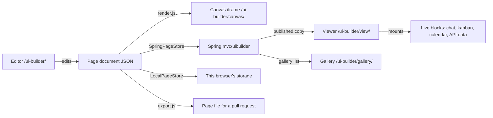

## What it is

The UI Builder lets a student make a page on this site without writing HTML. A page is a
JSON **document** of **sections** ("One column" or "Columns") holding **blocks**. Blocks are
the shared `ocs__` grammar (headers, cards, stats, tables, link cards…), live **communication
blocks** (group chat, announcements, message us, team members, calendar, kanban, visitor
feedback) and **project blocks** (data from your API, embed your app). One renderer turns a
document into `ocs__` markup. Nothing a student types ever runs as HTML or JavaScript.



## Flask only or Flask + Spring

| | Flask only (`spring: false`) | Flask + Spring |
|---|---|---|
| Save | this browser (`LocalPageStore`) | Spring (`SpringPageStore`), with a browser copy for crash recovery |
| Share | export the page file or JSON | publish, then the viewer link and the gallery |
| Blocks | every block except the ones that need Spring (chat, members, message us, announcements, calendar) | every block |
| Team editing | no | owner, teachers and the page's team group |

The page bootstrap picks the store class once from `springEnabled`. The editor reads
`store.capabilities` and never checks `springEnabled` itself. Whether Flask should store
pages too is an open question for the kit owners.

## Pages

| Route | Source | What it is |
|---|---|---|
| `/ui-builder/` | `pages/editor.md` | the editor (`?page=<id>` Spring, `?local=<id>` browser, `?new=<template>`) |
| `/ui-builder/canvas/` | `pages/canvas.md`, `layouts/ui-builder-canvas.html` | the editor's preview frame: the site head and theme, no navbar |
| `/ui-builder/view/` | `pages/view.md` | a page: `?page=<slug>` published, `?draft=<id>` for editors and teachers, `?local=<id>` |
| `/ui-builder/gallery/` | `pages/gallery.md` | published pages, filtered by course and search |

All four are `hide: true`, `search_exclude: true`, `regenerate: true` (they read `site.spring`)
and `noindex`. `_includes/ui_builder_data.html` writes the registry, the school pack, course
titles and (on the editor) its strings as JSON scripts; with `widgets=true` it also writes the
kanban defaults, the school calendar and the two widgets' empty templates.

## The page document

```json
{ "schemaVersion": 1, "kind": "ocs-ui-page",
  "page": { "title": "Flood Watch", "description": "", "byline": "Binary Beasts", "course": "csp", "width": "contained", "image": "" },
  "sections": [ { "id": "s-7f3k9q", "type": "columns", "settings": { "layout": "sidebar_right" }, "hidden": false,
                  "cells": [ { "blocks": [ { "id": "b-2m8x0d", "type": "text", "settings": { "body": "…" }, "hidden": false } ] }, { "blocks": [] } ] } ] }
```

- ids are `s-`/`b-` plus 6–12 lowercase letters and digits.
- Column layouts reuse the grammar: `halves` → `ocs__split`, `thirds` → `ocs__facts`,
  `sidebar_left` → `ocs__split--aside`, `sidebar_right` → `ocs__split--aside-end`.
- **Key convention** that lets Spring check a document without a copy of the block list: URL
  values live only under keys named `url`, `src`, `image` or `link`; rich text only under `body`;
  API field mappings end in `_path`. `tests/registry.test.mjs` enforces it.
- Limits (sections, blocks, live blocks, size, nesting) are in the registry's `limits` and in
  Spring's `ui-builder.limits.*`. Keep them equal.

## The registry

`data/ui_builder.yml` is the generic registry: limits, devices, categories, frames, layouts,
page fields, blocks with their fields, starter templates and every visible string.
`data/ui_builder_school.yml` is the school pack, merged over it: course codes (titles come from
each course's `course.title`, like Profile), the announcements and calendar blocks, the CSP
templates and school wording. `data/ui_builder_editor.yml` holds the editor's strings. No
module hard-codes a visible string; they all go through `textOf`.

Adding a block: add its definition (label, help, icon, category, fields) to a registry file,
add a renderer to `blocks-content.js` (and a mount to `blocks-live.js` or `blocks-project.js`
if it is live), follow the key convention, and add it to the shared fixture `all-blocks.json`
in both repos.

## Rendering and safety

- `render.js` → a **vnode** tree (`vnode.js`). `toDOM` builds it with `createElement`,
  `setAttribute` and text nodes; `toHTML` writes the same tree as a string for the page-file
  export and Show HTML.
- `vnode.js` allows a fixed list of tags and attributes with fixed values (`sandbox`, `allow`,
  `target`, `referrerpolicy`, `id`, class tokens). `href`/`src` are re-checked. `toHTML` escapes
  `{` and `}` everywhere except generated include tags, so Liquid never runs in an exported page.
- Rich text goes through `assets/js/chat/rich-text.js` (the chat sanitizer), then
  `rich-content.js` re-checks every link: only https and mailto stay, and they open in a new tab
  with `rel="noopener noreferrer nofollow"`.
- `url-rules.js` checks every link, image, embed and API address: no hidden characters,
  backslashes, `user:pass@` prefixes or protocol-relative links; site paths must stay on this site.
- Login cookies cover the whole `opencodingsociety.com` domain, and student team servers live
  under it. So images from those hosts load with `crossorigin="anonymous"` (no cookies), and
  apps on them open in a new tab instead of inside the page. Other embeds are https only, sandboxed,
  and load only when a visitor presses Open or Play.
- Each block renders inside its own error boundary: one broken block never blanks a page.

## Live blocks and their owners

| Block | Owner module (source) | Data |
|---|---|---|
| Group chat | Messages `conversation-embed.js` `mountGroupChat` | Spring group chat: REST to send, STOMP to receive |
| Class announcements | the same, read-only, on `<course>-announcements` | Spring group chat |
| Message us | `SpringPageStore.messageOwner(slug)` → `/dm?dm=<id>` | Spring DMs, owner resolved on the server |
| Team members | `SpringPageStore.members(slug, blockId)` | names only, from the published page's group |
| Class calendar | Courses `calendar-card.js` `createCalendarCardSection` + `mountCalendarCard` | Spring calendar; the school week when signed out |
| Kanban board | `assets/js/kanban-board.js` `createKanbanSection` + `mountKanbanBoard` | GitHub (60 requests an hour per network, so it loads on click) |
| Visitor feedback | `assets/js/api/microblog.js` | Flask microblog, keyed by the page address |
| Data from your API | `api-data.js` `fetchJson` | the student's own API, without cookies |

In the editor canvas no live block mounts: each shows a sample made from registry text. Only
"Data from your API" fetches there, and only with "Real data while editing" on.

## Saving

- **Stores** share one interface: `list`, `create`, `open`, `save(ref, page, {base})`, `remove`,
  plus `capabilities`. `SpringPageStore extends LocalPageStore` and adds publish, visibility,
  revisions, leases, gallery and the teacher list. `base` is the browser revision or Spring's
  draft version; a stale `base` is a `ConflictError`.
- **History** (`history.js`) keeps undo/redo; typing in one field within 800 ms is one step.
- **Autosave** (`autosave.js`): idle → dirty → saving → idle, conflict or error, one request in
  flight. Every save also writes a browser draft (`draft-store.js`) for crash recovery.
- **Leases**: the editor holds a 60-second edit lease and renews it; a teammate who opens the page
  meanwhile sees "{name} is editing · Take over".

## Spring

Spring's `mvc/uibuilder` (see its `docs/ui-builder-architecture.md` and `api/ui-builder.http`)
stores the draft, the published copy and, once a teacher approves it for everyone, the public
copy. Anonymous visitors get only the approved copy, with no person's name; anyone who can't
edit a page gets 404. Every route except the two public reads accepts only exact allowed origins
(not the `*.opencodingsociety.com` CORS pattern, which includes student servers).

## Testing

```bash
node --test _projects/systems/ui-builder/tests/*.test.mjs
bundle exec ruby scripts/test_ui_builder.rb
```

The spec fixtures in `tests/fixtures/specs/valid` and `invalid` are byte-identical to Spring's
`src/test/resources/ui-builder/`; both validators must accept and refuse the same files.
`*-on-publish.json` is a valid draft that fails only when published.

## Known issues

- Spring checks neither group membership on group chat nor who subscribes to a STOMP topic. The
  chat block shows a group's chat only to its members, but that is a convenience, not access
  control.
- Login cookies are domain-wide (`.opencodingsociety.com`), so any script on a student server can
  call Spring as its visitor. Making the cookie host-only would let team apps be embedded again.
- The kanban board shares GitHub's 60 unauthenticated requests an hour per network.
- Spring's MySQL path (the table initializer's MySQL dialect) is reasoned, not yet run.

## Change checklist

- A new or changed limit: the registry's `limits` and Spring's `ui-builder.limits.*` together.
- A new field or block: the key convention, `all-blocks.json` in both repos, and a renderer test.
- A new visible string: a registry file, never the code.
- AGENTS.md and AGENTS_MD_DOCUMENTATION.md together when these rules change.
